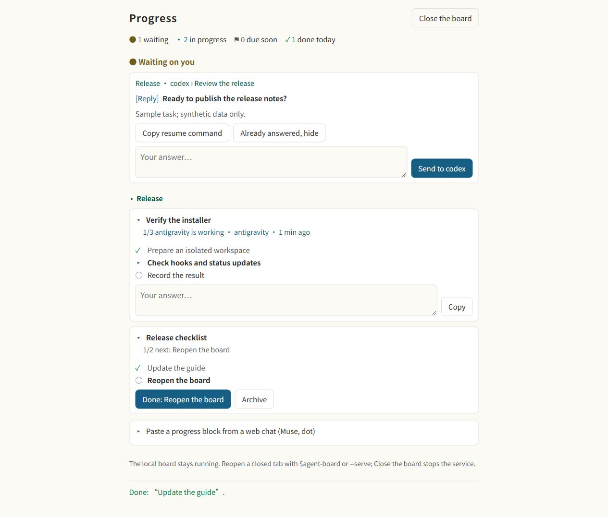

# Agent Board

用一个本地看板查看各 agent 的工作、问题与下一步。从你正在使用的 agent 开始，不必先安装 Claude Code。

[](CHANGELOG.md) [](LICENSE)

[English](README.md) · [繁體中文](README.zh-TW.md) · 简体中文

- 按项目查看工作，优先显示问题与阻塞。
- 勾选手动步骤、归档工作、复制回复，将问题标成已读或恢复显示。
- 原生 hooks 更新活动状态；agent 明确汇报自己的任务步骤。
- 卡片对应到在线的确切 session 才能发消息，收到真正回复才确认送达。

## 快速开始

<details open>
<summary><b>让 agent 帮你安装</b></summary>

将这段贴给你使用的 agent：

```text
请从 https://github.com/WenyuChiou/agent-board 在这台电脑安装 Agent Board。
读取 AGENTS.md、README 与 docs/SETUP.md，识别当前 host 和其他已安装的 coding agent，先预览 node scripts/setup-agent.mjs。
保留现有设置与共享进度路径。遵循我对永久变更的批准要求，再安装适用的 hooks、plugin 与看板 skill；不要要求或调用另一家 AI 才能初始化。
完成必要的限定信任、读回设置，让当前 session 汇报自己的真实进度，并打开交互看板。
分别验证 CLI、桌面 App 和 IDE 的真实 hook 事件。安装完成、进度汇报与消息送达是不同的验收。
列明哪些 session 要重新加载，以及哪些 adapter 尚未支持或验收。不要扫描私密对话，也不要默默跳过阻塞。
```

</details>

或使用 Node.js 18+ 与 Git：

```sh
git clone https://github.com/WenyuChiou/agent-board.git
cd agent-board
node scripts/setup-agent.mjs
# 检查并批准计划后：
node scripts/setup-agent.mjs --apply
```

安装器识别配置目标，不代表 agent 正在运行。它安装看板与现有 adapter，不会安装 AI 应用。新安装默认使用 `~/.agent-board/progress.md`，现有安装保留原路径。[安装与移除](docs/SETUP.md)。

## 支持的 agent

| Host／界面 | 当前范围 |
| --- | --- |
| Codex | 独立安装、六个 hooks 与自身 thread 汇报。已验证独占 app-server 的原生 hooks／ACK；CLI TTY、桌面 App 自动 hooks 与收信仍须分别验收。 |
| Antigravity CLI | 独立安装、四个原生 hooks 与独占 stream 发消息，已在 Windows 实测。App／IDE 单独验收。 |
| Cursor、OpenCode、Grok Build、Muse Code | 可生成独立 hooks 或 plugin；原生运行与收信依 host 而异，不能只凭安装判定通过。 |
| OpenClaw、DeepSeek Harness | 独立原生状态 plugin 与 skill；隔离回调／加载检查通过。原生应用及收信仍未验收。 |
| Hermes Agent | 看板与 skill；独立生命周期 adapter 待完成。 |
| Claude Code | 可选原生侧栏、Task 镜像与 plugin 连接流程。 |
| dot 与其他网页 agent | 明确进度转发；尚未验证原生收信。 |

详见 [adapter 范围](docs/SETUP.md#native-status-adapters)、[各界面消息能力](docs/MESSAGING.md#agent-and-surface-support)及[原生验收记录](docs/validation/2026-10-19-native-hooks.md)。

<details>
<summary>旧 Gemini CLI 兼容性</summary>

当前普通用户入口是 Antigravity CLI。独立的 `--agent gemini` 保留给仍受支持的企业／API host，不是 Antigravity 别名。[Google 转换公告](https://developers.googleblog.com/an-important-update-transitioning-gemini-cli-to-antigravity-cli/)。

</details>

## 每个 agent 里都看得到看板

请已安装的 Agent Board skill 打开看板（Codex 使用 `$agent-board`，OpenCode 使用 `/board`），或运行：

```sh
node ~/.agent-board/agent-board.mjs --serve
```

Windows 或自定义安装请使用安装器打印的确切路径。`--watch` 是终端交互看板，`--chat` 输出精简文字，`--html` 生成只读网页。[使用指南](docs/GUIDE.zh-CN.md#每个-agent-里都看得到看板)。

### 看板的网页

`--serve` 打开交互网页，可勾选手动步骤、归档、导入有效进度块、复制回复、标记已读及恢复显示；当前没有通用任务编辑表单。只有确切 session 的 adapter 在线时才显示**发送**；离线卡片保留**复制**及可用的**复制续接命令**。[启用消息](docs/MESSAGING.md)。

关闭标签页不会停止服务，再运行同一命令即可重开；**关闭看板**才会停止。默认不会闲置关闭，`--idle-minutes 30` 才启用。`--lan` 为可选功能，另有访问限制，详见[安全说明](SECURITY.md)。



*合成数据的界面示例。Send 需要在线 adapter；截图不是原生送达证据。*

## 可选 Claude Code 侧栏

需要 Claude Code 2.1.287+（离线 CI 使用 2.1.301）：

```sh
claude plugin marketplace add WenyuChiou/agent-board
claude plugin install agent-board@agent-board
```

打开 Claude Code 后使用 `/progress`。Task 镜像、快速新增、报告、通知与 `/progress connect` 属于 plugin 功能；其他 agent 可独立初始化。[使用指南](docs/GUIDE.zh-CN.md)。

## 文档

[安装](docs/SETUP.md) · [指南](docs/GUIDE.zh-CN.md) · [Codex](docs/CODEX.md) · [消息](docs/MESSAGING.md) · [文件格式](docs/FORMAT.md) · [远程汇报](docs/REMOTE_REPORTERS.md) · [开发](CONTRIBUTING.md)

报告问题请提供看板／host 版本、CLI／App／IDE 界面及合成复现数据。不要上传私密对话、凭证或含 token 的看板链接。
